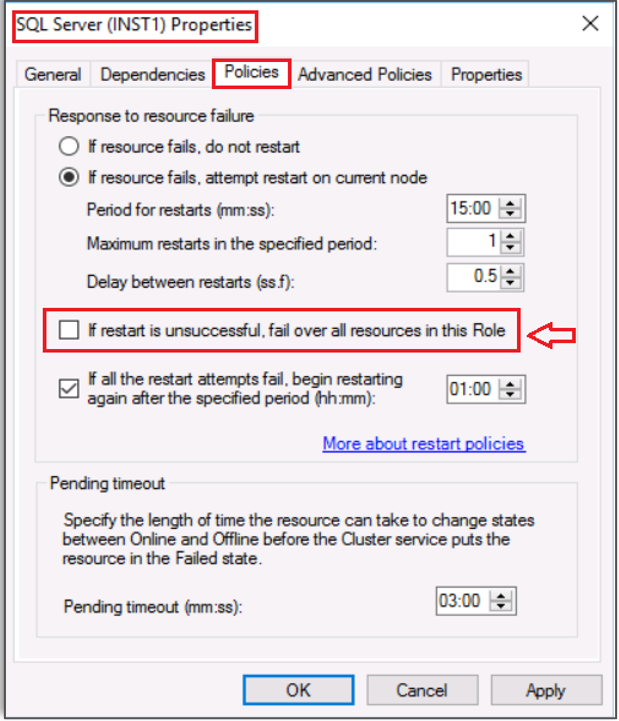

SQL Server was stopped using

To simulation failure to test automatic `failover`

### 1. In this scenario you are failing the SQL Server agent to attempt to start it after disable the agent xps and when it failed to bring it online it will trigger the automatic failover for the other resource
```powershell
sqlcmd -S .\INST1 -E
exec sp_configure 'show advanced options',1;recofigure;
go
exec sp_configure 'Agent xp',0;recofigure;
go
exit
Stop-Process -Name SQLAgent$INST1
Start-Process -Name SQLAgent$INST1
```




### 2. In this scenario you are restarting the SQL Server to trigger the automatic failover
```powershell
NET STOP MSSQL$INST1 /Y
#Or
Stop-Process -Name sqlservr -Force
#Or
Stop-Service -Name 'MSSQL$INST1' -Force
```

Or

```powershell
$loop = 0
$service = (get-service -name "*sql*" | where {$_.DispalyName -like "*SQL Server (*"}).name
$status = (get-service -name $service).status
while ($status -eq "Running") {
  Stop-Service -Name $service -Force
  Start-Sleep -Seconds 20
  $status = (get-service -name $service).status
  $loop++
  "Attempted no" $loop
}
```
